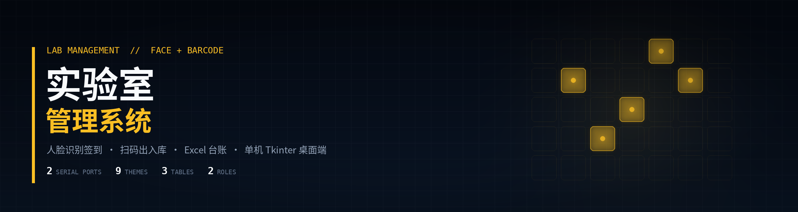
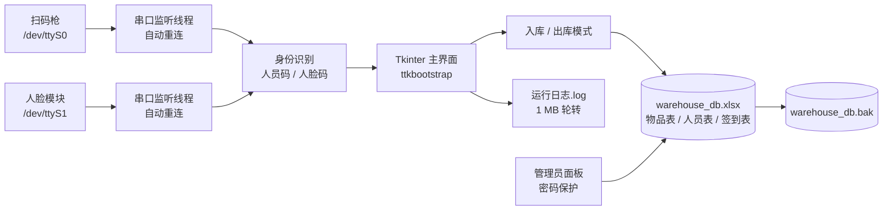
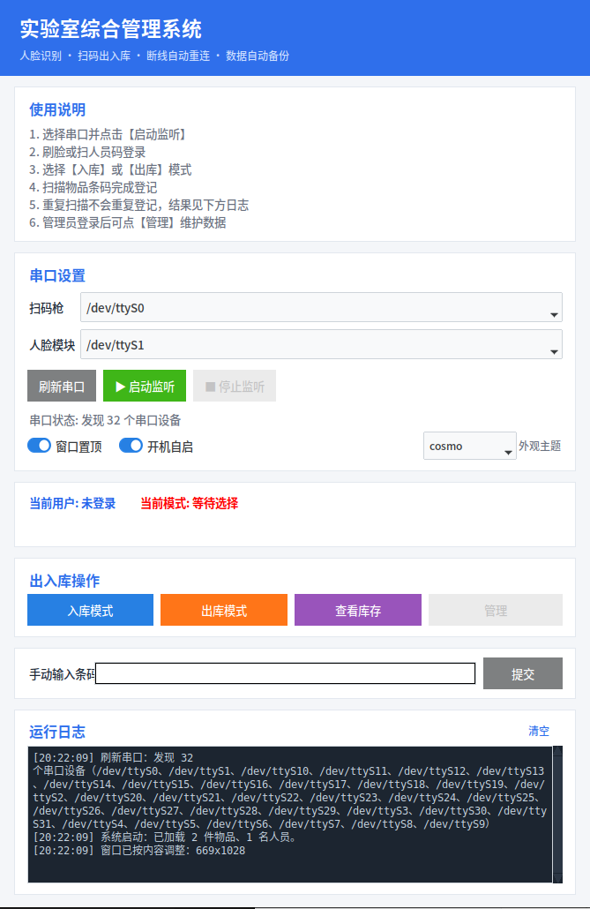

<p align="center">
  
</p>

<p align="center">
  
  
  
  
  
  <a href="LICENSE"></a>
</p>

<p align="center">
  <strong>刷脸签到 · 扫码出入库 · Excel 即台账</strong><br>
  <sub>双串口监听 · 断线自动重连 · 原子写入 + 备份恢复 · 单机 Tkinter 桌面端</sub>
</p>

---

> [!NOTE]
> 这是**单机桌面工具**，不是多用户服务端：数据存在一个 Excel 工作簿里，适合一台或两台实验台电脑使用。并发写入、集中部署、加密存储都不在其设计范围内。

| 串口通道 | 外观主题 | 工作表 | 角色 |
| :---: | :---: | :---: | :---: |
| **2 路** | **9 款** | **3 张** | **2 级** |

## 项目简介

实验室的出入库与人员签到往往靠纸质登记或临时表格：物品状态说不清，签到记录对不上，换人接手就断档。

本项目把两件事放进同一个桌面程序：

- **人员进出**：人脸模块刷脸自动签到，或扫人员码登录；
- **物品进出**：扫码枪扫物品码，切换入库 / 出库模式即时登记操作人、时间与柜号。

数据直接写入 `warehouse_db.xlsx` 的「物品表 / 人员表 / 签到表」，不需要数据库服务；断电、拔插串口、误操作都有对应的保护。

## 功能

| 模块 | 能力 |
| --- | --- |
| **出入库** | 双串口同时监听扫码枪与人脸模块；切换入库 / 出库模式；记录柜号、操作人、时间 |
| **签到** | 刷脸自动签到；扫人员码快速登录；短时间重复刷脸不重复签到（窗口可调） |
| **去重** | 同一物品重复登记会识别并提示，不覆盖已有记录 |
| **权限** | 管理员 / 成员两级；管理员面板（密码保护）增删人员与物品，操作全部留痕 |
| **稳定性** | USB 拔插 2 秒内自动重连；写前备份、原子替换、损坏自动恢复 |
| **界面** | 卡片式布局 + 语义色按钮；9 款主题（含深色）；库存表按在库 / 出库着色 |
| **日志** | 所有操作、串口事件与异常写入 `运行日志.log`，超过 1 MB 自动轮转 |
| **部署** | 一键安装脚本：虚拟环境、依赖、桌面快捷方式、开机自启、串口权限 |

## 架构



数据流是单向的：串口线程只负责解析行数据，所有写入都回到主线程经 `WarehouseDB` 完成，避免跨线程操作 Tkinter 控件。

## 数据模型

`warehouse_db.xlsx` 固定三个工作表：

| 工作表 | 列 | 说明 |
| --- | --- | --- |
| **物品表** | 条码 / 物品名称 / 柜号 / 状态 / 最后操作时间 / 最近操作人 | 主键为条码；重复条码加载时给出警告 |
| **人员表** | 条码 / 姓名 / 角色 | 角色为管理员或成员 |
| **签到表** | 首次运行自动创建 | 记录签到时间与人员 |

> 条码列请保持**文本格式**（右键单元格 → 设置单元格格式 → 文本），否则长条码会被 Excel 转成科学计数法。

## 快速开始

```bash
git clone https://github.com/MCYX12/lab-management-system.git
cd lab-management-system

# 1. 复制示例台账（真实数据不入库）
cp warehouse_db.example.xlsx warehouse_db.xlsx

# 2. 一键安装：venv、依赖、桌面图标、开机自启、dialout 串口权限
chmod +x install_ubuntu.sh run.sh
./install_ubuntu.sh

# 3. 启动
./run.sh
```

首次使用把示例 Excel 改成自己的物品与人员数据；`run.sh` 会激活虚拟环境并启动 `main.py`。

## 使用流程

<p align="center">
  
</p>

1. 在「串口设置」选择扫码枪与人脸模块端口，点 **▶ 启动监听**。
2. **刷脸**或**扫人员码**登录，状态栏显示当前用户。
3. 点「入库模式」或「出库模式」。
4. 扫描物品条码，状态栏提示结果，库存表实时更新。
5. 管理员登录后可进入「管理」，维护人员、物品与角色。

## 稳定性设计

| 场景 | 处理 |
| --- | --- |
| USB 拔插 / 串口断开 | 2 秒内自动重连，无需重启程序 |
| 写入中断电 / 崩溃 | 先写 `*.tmp` 再 `os.replace` 原子替换，主文件不会半写 |
| 误操作 | 每次写库前复制 `warehouse_db.bak` |
| 主文件损坏或丢失 | 启动时自动从 `.bak` 恢复，并在日志中标注 |
| 外部修改 Excel | 按文件 mtime 自动重新加载 |
| 重复扫码 / 重复刷脸 | 物品按状态去重提示；签到按时间窗口去重 |
| 多实例 | 单实例锁，避免两个窗口同时写同一个工作簿 |

## 无硬件调试

没有扫码枪或人脸模块也能走完整流程：在「手动输入条码」里输入人员码 / 物品码并提交，或使用示例数据直接测试入库、出库、查询与导出。

## 目录结构

```text
main.py                     Tkinter 主程序（界面、串口线程、业务流）
db.py                       Excel 台账读写、备份、原子写入与恢复
warehouse_db.example.xlsx   示例数据（物品表 / 人员表）
install_ubuntu.sh           依赖安装、桌面图标、开机自启、串口权限
run.sh                      启动脚本
实验室综合管理系统.desktop   桌面快捷方式
docs/screenshot.png         界面截图
README_UBUNTU.md            Ubuntu 部署补充说明
```

## 验证与限制

- 已验证：双串口监听与断线重连、刷脸 / 扫码登录、入库出库、重复扫码提示、签到去重、备份与损坏恢复、9 款主题切换、开机自启。
- **无自动化测试**：本项目以手工流程验证为主；改动串口解析或写库逻辑后请用示例数据回归一遍。
- 仅支持 Ubuntu / Linux 桌面（依赖 `/dev/ttyS*` 与桌面自启）；Windows 未适配。
- 单机单用户写入；不要多台电脑同时打开同一个 Excel 文件。
- 数据未加密；台账与备份请按敏感资料保管。

## 许可

[MIT](LICENSE)。
